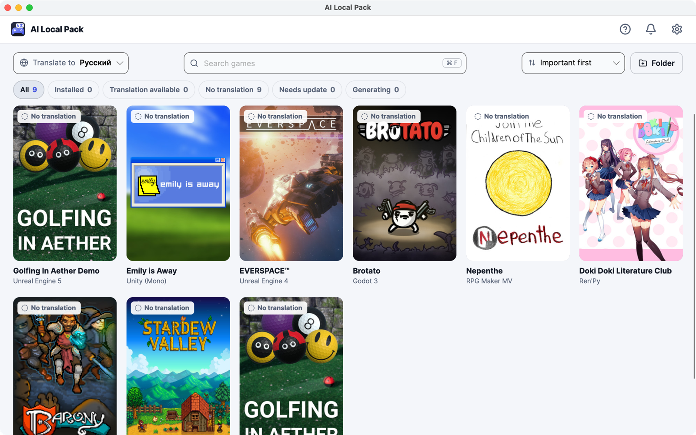
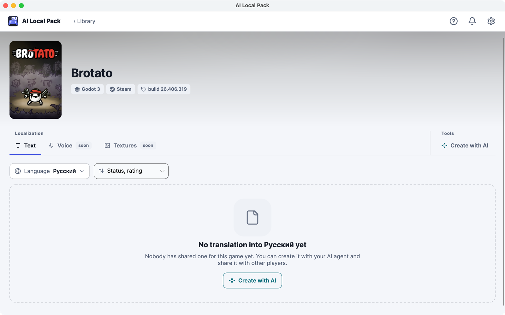

<h1 align="center">AI Local Pack</h1>

  <b>Play your games in your language.</b> 
  Install a translation other players made, or create one with AI in a few clicks. 
  Free and open source, for Windows, macOS and Linux.

  <a href="#download"><b>Download</b></a> ·
  <a href="#how-to-use-it">How to use it</a> ·
  <a href="#questions">Questions</a> ·
  <a href="https://github.com/ailocalpack/registry">Translations</a>

## What it does

- **Finds your games.** Your Steam library shows up on its own. Games from elsewhere: add their folder.
- **Shows which games have a translation** into your language and installs one with a single click.
- **Creates a translation when there is none.** An AI agent (Claude Code or Codex, on your own subscription) translates the game's text. You review the names and terms, then play.
- **Shares it with everyone.** Publish your translation in one click so other players get it too.
- **Undo any time.** Every file a translation changes is backed up first. Uninstall it and the game is as it was.

## Download

| Your computer | Installer | Without installing |
|---|---|---|
| **Windows** (most PCs) | [Download `.exe`](https://github.com/ailocalpack/ailocalpack/releases/latest/download/AiLocalPack-win-x64-Setup.exe) | [Portable `.zip`](https://github.com/ailocalpack/ailocalpack/releases/latest/download/AiLocalPack-win-x64-Portable.zip) |
| **Windows on ARM** (Snapdragon laptops) | [Download `.exe`](https://github.com/ailocalpack/ailocalpack/releases/latest/download/AiLocalPack-win-arm64-Setup.exe) | [Portable `.zip`](https://github.com/ailocalpack/ailocalpack/releases/latest/download/AiLocalPack-win-arm64-Portable.zip) |
| **Mac with Apple chip** (M1, M2, M3…) | [Download `.pkg`](https://github.com/ailocalpack/ailocalpack/releases/latest/download/AiLocalPack-osx-arm64-Setup.pkg) | [Portable `.zip`](https://github.com/ailocalpack/ailocalpack/releases/latest/download/AiLocalPack-osx-arm64-Portable.zip) |
| **Mac with Intel** | [Download `.pkg`](https://github.com/ailocalpack/ailocalpack/releases/latest/download/AiLocalPack-osx-x64-Setup.pkg) | [Portable `.zip`](https://github.com/ailocalpack/ailocalpack/releases/latest/download/AiLocalPack-osx-x64-Portable.zip) |
| **Linux** (64-bit) | [Download `.AppImage`](https://github.com/ailocalpack/ailocalpack/releases/latest/download/AiLocalPack-linux-x64.AppImage) | the AppImage needs no installing |

The links always point to the latest version. All versions and what changed: [Releases](https://github.com/ailocalpack/ailocalpack/releases).

**Which Mac do I have?** Apple menu → *About This Mac*. *Chip: Apple M…* means Apple chip; *Processor: Intel…* means Intel.

The app updates itself: when a new version is ready, it offers *Restart to update*.

### First start: "unknown app" warnings

The app isn't code-signed yet, so your system asks once whether you trust it. That's expected for now:

- **Windows** shows *Windows protected your PC*: click **More info** → **Run anyway**.
- **macOS** says the app *can't be opened* or *can't be checked*: open **System Settings → Privacy & Security**, scroll down and click **Open Anyway** next to AI Local Pack.
- **Linux**: allow the file to run (right-click → *Properties* → *Allow executing file as program*, or `chmod +x AiLocalPack-linux-x64.AppImage`), then double-click it. If nothing happens, install FUSE 2 (`libfuse2` on Ubuntu / Debian).

## How to use it

### Install a translation

1. Open the app. Your Steam games appear. Another game? Click **Folder** and pick the folder it is installed in.
2. Choose your language at the top: **Translate to …**. Games that have a translation are marked *Translation available*.
3. Open a game, pick a translation and click **Install**. Then play as usual.

To go back to the original, open the game and click **Uninstall**.

### Create a translation with AI

No translation for your game yet? Open it and click **Create with AI**.

- You need **Claude Code** (with a Claude Pro or Max subscription) or **Codex** (with a ChatGPT Plus or Pro subscription). The app installs the agent for you if it's missing and opens its sign-in. AI Local Pack itself costs nothing; the AI work counts against your own subscription.
- Before starting, the app shows how big the job is. A large game can take hours, and if your subscription's limit runs out, the app waits and continues on its own.
- Halfway through, you can check the list of names and terms (characters, places, how characters address each other) and fix anything you'd translate differently.
- When it's done, click **Install & play**.

### Share it

After you've tried your translation in the game, click **Publish**. The first time, the app asks you to sign in with a free GitHub account. Other players then see your translation in their app, can rate it, and it becomes **verified** once three players confirm it works.

## Questions

**Is it free?**
Yes, the app and every translation in it. Only creating a new translation with AI uses your own Claude or ChatGPT subscription.

**Which games work?**
Most games made with Unity, Unreal Engine 4 / 5, RPG Maker MV / MZ, Ren'Py and Godot. The app shows a game's engine on its card. For other engines the AI can still try to make a translation, with less certainty.

**Is it safe for my game?**
Installing a translation runs only the app's own code: no AI and no downloaded scripts touch your game. Translations contain only text, never programs, and every file they change is backed up so you can undo. The AI works on a copy of the game, never on the game itself.

**Can I get banned?**
Games with anti-cheat (Easy Anti-Cheat, BattlEye, Vanguard and others) are blocked: the app won't change them, unless the game officially allows mods.

**What happens when the game updates?**
A Steam update can overwrite the translation. The app notices and puts it back if it still fits the new version. If it doesn't, the app tells you and offers a newer version of the translation, or to translate only the new text with AI.

**Which languages?**
Any language Steam supports, as the language you translate games into. The app itself is in English, Deutsch, Español, Français, Italiano, 日本語, 한국어, Polski, Português (Brasil), Русский, Türkçe, Українська and 简体中文.

**Steam Deck? Epic, GOG?**
Planned. For now: Steam games, plus any game folder you add yourself (so Epic and GOG games work if you add their folder).

**A translation is wrong or doesn't work.**
Rate it in the app (*Doesn't work* with a short comment), or fix it with AI and publish the fix as its new version.

**How do I remove the app?**
First uninstall the translations you no longer want (each game's page). Then: Windows: *Settings → Apps*, AI Local Pack → *Uninstall*. macOS: move *AI Local Pack* from *Applications* to the Trash. Linux: delete the AppImage.

**Where do the translations come from?**
From players like you: they live in the public [translation registry](https://github.com/ailocalpack/registry) on GitHub. There is no server of our own: just the app, GitHub and your own AI subscription.

## Status

Early version: things may still break. Planned next: voice-over and translated textures in games, Steam Deck, more stores, and your own API key or a local AI model. Found a bug? [Open an issue](https://github.com/ailocalpack/ailocalpack/issues).

## For developers

The app is C# / .NET 10 with [Avalonia UI](https://avaloniaui.net/). Building, tests and conventions: [CONTRIBUTING.md](CONTRIBUTING.md). The command-line tool (also used by the registry's CI) ships with each release as `ailocalpack-cli-<version>-<os>`; every feature with its commands: [docs/status.md](docs/status.md). Component specs live in [docs/](docs).

- **App UI translations**, bug reports and code go to this repository ([CONTRIBUTING.md](CONTRIBUTING.md)).
- **Game translations** go to the [registry](https://github.com/ailocalpack/registry) as pull requests (the app does this for you).

## Licenses

The app: Apache-2.0. Translations in the registry: CC BY-SA 4.0.

Translations contain no game files. Please own the games you translate. Studios that object to fan translations of their game can ask for it to be opted out of the registry ([LEGAL.md](https://github.com/ailocalpack/registry/blob/master/LEGAL.md)).
