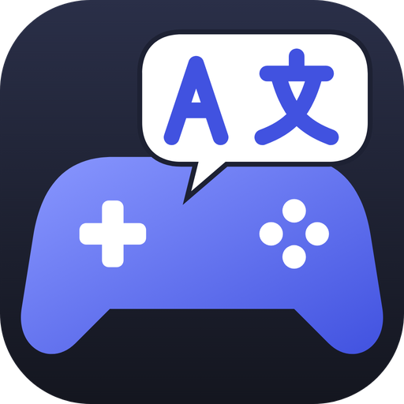

<p align="center"></p>

# AI Local Pack

A free, open-source desktop app for Windows, macOS and Linux (Steam Deck included). It lets you **install** a community translation for a game you own, or **generate** a new one with an AI agent and **publish** it for other players.

> **Status: early development.** Nothing is released yet. What works today: the game library (Steam and folders you add yourself), engine and anti-cheat detection, the pack format, compatibility checks, and the public registry with its CI. You can also see, per game, whether a translation exists for your language. Installing, generating and publishing are next. The roadmap is below.

## How it works

1. **Discover.** The app finds your Steam games. You can also add any game folder by hand.
2. **Identify.** Each game gets a stable ID: its Steam app ID, or a fingerprint of its files. Each game also gets a version: the Steam build ID, or a set of file hashes.
3. **Browse.** You see which games have a translation (a *pack*) into your language in the public [registry](https://github.com/ailocalpack/registry).
4. **Install.** One click. The app's own built-in code applies the pack: no AI and no third-party scripts run on your machine. Every file the pack changes is backed up, so you can uninstall it.
5. **Generate.** If no pack exists, the app can have an AI coding agent make one: Claude Code or Codex, on your own subscription. The agent works on a copy of the game, never on the game folder itself.
6. **Publish.** You can share the result through a pull request to the registry, signed in with your GitHub account.

A pack holds data only: translated strings plus a *recipe* that names the built-in tool to rebuild the game files from your own copy, or a binary patch as a fallback. It never contains the game's original text or files, and the registry's CI rejects any executable file. Games with anti-cheat are blocked, unless the game officially allows mods.

There is no server: the whole system is the app, GitHub and your own AI agent account.

## Roadmap

- **MVP:** text translations. Steam plus folders you add. Install, generate and publish on all three OSes. Supported engines: Unity, Unreal Engine, RPG Maker MV/MZ, Ren'Py, Godot.
- **Phase 2:** voice-over (TTS). **Phase 3:** translated textures.
- **Later:** more stores (Epic, GOG, EA app), your own API key or a local model, a manual string editor.

## Building from source

Requirements: the [.NET 10 SDK](https://dotnet.microsoft.com/download) (pinned in `global.json`).

```sh
dotnet build                                  # whole solution; warnings are errors
dotnet test                                   # all tests (xunit.v3 on Microsoft.Testing.Platform)
dotnet run --project src/AiLocalPack.Desktop  # the desktop app
dotnet run --project src/AiLocalPack.Cli -- games list
```

The CLI ships as one self-contained file per OS: `dotnet publish src/AiLocalPack.Cli -c Release -r <rid>`.

### CLI

| Command | What it does |
|---|---|
| `games list [--json]` | Your Steam games with engine, anti-cheat and build |
| `toolkit detect <folder>` | Engine and anti-cheat of a game folder |
| `toolkit scan-folder <folder>` | Every game in a folder, with its fingerprint and version |
| `toolkit extract <folder> --out <file> [--lang <tag>]` | A game's strings as an editable string table (RPG Maker, Ren'Py, Godot, Unity, Unreal) |
| `toolkit rebuild <folder> --strings <table> --out <folder>` | Rebuilds translated files into a separate staging folder |
| `dev fixture <rpgmaker\|renpy\|godot\|unity\|unreal> <folder>` | Writes a synthetic game for manual checks |
| `index show [--game <id>] [--lang <tag>]` | Packs in the registry index |
| `pack check <pack> --game <id>` | Whether a pack fits your installed copy |
| `pack validate <folder>…` | What registry CI checks for each pack |
| `index build <registry> --out <file>` | Builds `index.json` from a registry checkout |

### Useful environment variables

- `AILOCALPACK_HOME=<dir>`: keeps settings, data and cache under one folder. Use it to keep your real data untouched while testing.
- `AILOCALPACK_INDEX_URL=<folder or URL>`: reads another registry, for example the sample one in `tests/fixtures/registry`.
- `AILOCALPACK_STEAM_ROOT=<dir>`: uses this folder as the Steam install instead of looking for one.

## Repository layout

```
src/
  AiLocalPack.Core      game catalog, Steam discovery, pack and registry formats, compatibility
  AiLocalPack.Toolkit   engine detection, anti-cheat detection, folder scanning (later: extract / rebuild)
  AiLocalPack.Agents    AI agent adapters (planned)
  AiLocalPack.Mcp       toolkit exposed to agents over MCP (planned)
  AiLocalPack.Cli       command-line tool, also used by registry CI
  AiLocalPack.Desktop   Avalonia UI app
tests/                  one test project per src project, shared TestKit, fixtures
schemas/                JSON Schemas of pack manifests, string tables and the registry index
```

Stack: C# / .NET 10 and [Avalonia UI](https://avaloniaui.net/) with MVVM (CommunityToolkit.Mvvm). The app UI is translated through `.resx` resource files: English and Russian for now, more to come.

## Contributing

- **Translations of games** go to the [registry](https://github.com/ailocalpack/registry) as pull requests. Once its CI passes, a pack PR merges on its own with status `alpha`. A pack becomes `verified` after other players confirm that it works.
- **Translations of the app UI** and code changes are pull requests to this repository. Add tests for what you change, and keep `dotnet build` free of warnings.

## Licenses

- App: Apache-2.0.
- Registry content (packs): CC BY-SA 4.0.

Packs contain no game files. Please don't use them with pirated copies. Studios that object to fan translations of their game can ask for it to be opted out of the registry.
